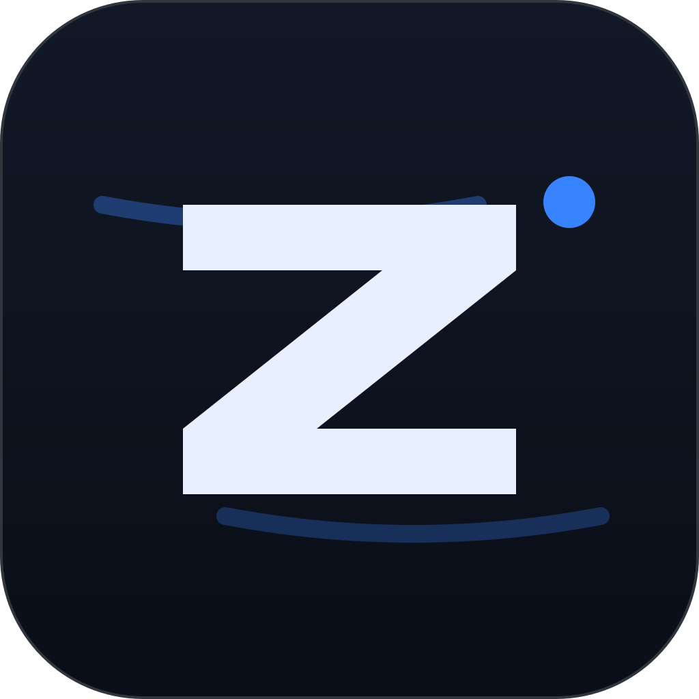
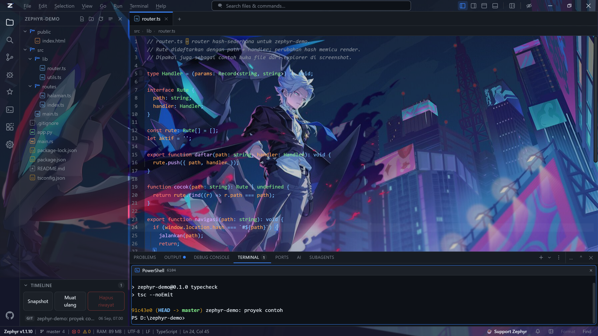
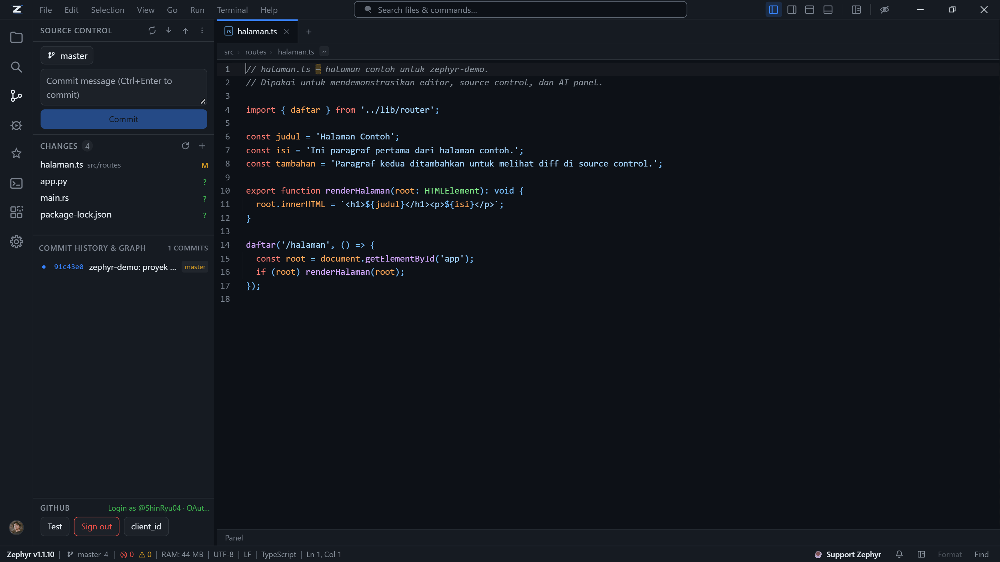
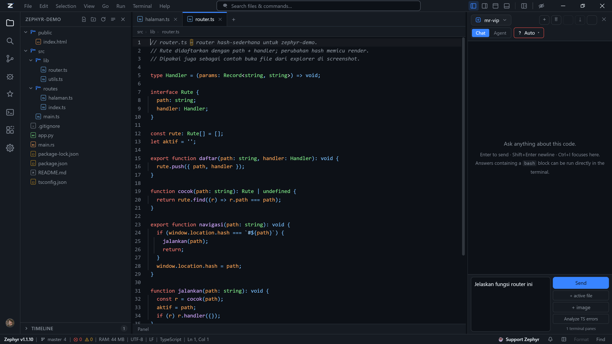
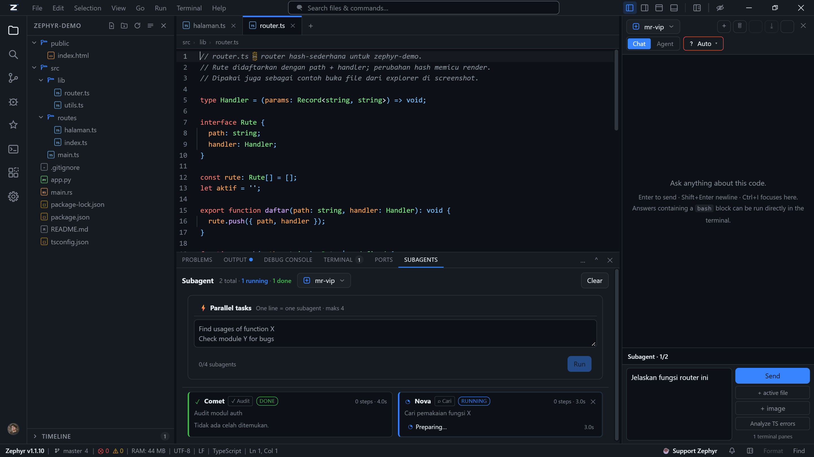
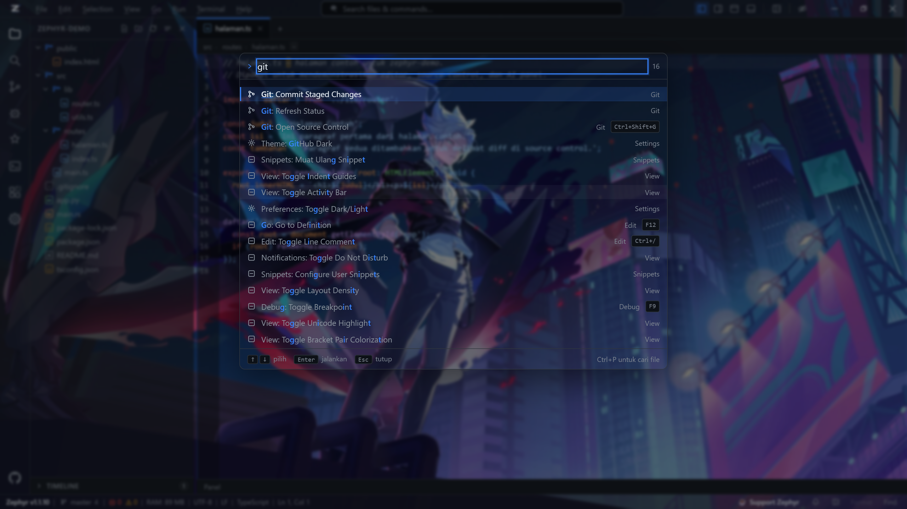

  
  <h1>Zephyr</h1>

  
<strong>A lightweight code editor that AI CLIs can drive.</strong>

  

    <a href="https://github.com/ShinRyu04/Zephyr/releases/latest">Download</a>
    ·
    <a href="SECURITY.md">Security</a>
    ·
    <a href="CHANGELOG.md">Changelog</a>
  

  

    
    
  

Zephyr is a desktop code editor built on Tauri 2 + Rust and React 18. On Windows there is no bundled browser runtime: it renders with WebView2, which already ships with the OS; on Linux it uses the system WebKitGTK. The editor is CodeMirror 6, the terminal is xterm.js over ConPTY on Windows and a PTY on Linux, and an MCP server on port 9222 lets Claude Code, Codex, Gemini CLI, or opencode read and drive the window. The installer is 7.9 MB and the executable is 21 MB. No telemetry. No account.

## Screenshots

<table>
  <tr>
    <td align="center"> Editor, file tree, and a terminal with TypeScript and git</td>
    <td align="center"> Source control with unstaged changes and inline diff</td>
  </tr>
  <tr>
    <td align="center"> AI panel with context meter, token count, and estimated cost</td>
    <td align="center"> Parallel subagents with roles, live steps, and cancel</td>
  </tr>
  <tr>
    <td colspan="2" align="center"> Command palette filtering the command list</td>
  </tr>
</table>

## Features

### Editor

- CodeMirror 6 with multi-file tabs, session restore, and split groups
- Encoding detection: UTF-8, BOM, Windows-1252, UTF-16 LE/BE
- Files over 4 MB open in a light read-only mode instead of freezing the UI
- Find and replace with regex and a step cap, plus multiple cursors and code actions
- Per-language LSP: completion, hover, go-to-definition, diagnostics, rename, format
- Debugging over DAP with breakpoints, stepping, watch, and call stack
- Rendered Markdown, and image, PDF, and SVG preview

### Terminal

- Up to 6 panes per tab: PowerShell, cmd, pwsh, bash, and WSL on Windows, or any shell on Linux, all over a native PTY
- Private Terminal whose scrollback is wiped on close
- A dedicated pane for an AI agent CLI (opencode, Claude Code, Codex, Gemini, Copilot)
- Browser pane through "Split With Browser", reading the real page rather than an iframe

### Source control

- Status, diff, stage, unstage, commit, discard, branch, and log
- Push, pull, fetch, and sync, with a pull-first prompt when the remote is ahead
- Inline blame for the active file, written to the Output panel
- Stash save, list, pop, and drop
- Conflict resolver with take-ours and take-theirs actions
- Write a commit message from the staged diff with one click
- Binary diffs labeled with their size, not raw bytes
- GitHub login through the OAuth device flow or a PAT

### AI

- Two modes: plain streaming chat, or an agent that reads files, runs commands, and works a task to the end
- Three adapter formats: OpenAI, Anthropic, and Gemini
- Tool calls sent as inline XML (DSML, tool_calls, antml) are parsed too, so gateway models that do not use the native field still run tools
- The workspace is summarized up front: detected stack, entry points, and file map, plus every AGENTS.md, CLAUDE.md, and .cursorrules file
- Each agent turn is told its own plan, step progress, and past failures, so it does not repeat a failed call
- Model catalog with logos; keys stay on the Rust side, the UI only sees a masked preview
- Local and custom providers, including Ollama and any OpenAI-compatible endpoint
- Subagents run in parallel from their own tab, each with a role, step log, and cancel
- Optional local RAG that feeds top project chunks to the model as context

### MCP server (port 9222)

- HTTP JSON-RPC with a Bearer token, loopback only, and can be turned off
- 20 tools to read panes, write the terminal, and edit buffers
- `editor_write` changes the buffer only and never writes to disk
- Requests wait for the UI to be ready and retry, so a call made during startup is not lost
- `/health` needs no token and does no UI work, so it cannot stall agent calls
- One click to register Zephyr with Claude Code, Codex, Gemini CLI, opencode, and more

### Customization

- 18 themes, including a High Contrast theme that passes WCAG AAA
- Background image for the editor, stored separately from the theme
- Customize Layout panel for the menu bar, activity bar, sidebar, panel, and status bar
- A 15-section settings page with remappable shortcuts and conflict detection
- UI available in 10 languages, defaulting to English

## Install

**Windows:** download the `.exe` (NSIS) or `.msi` installer from the [Releases](https://github.com/ShinRyu04/Zephyr/releases/latest) page and run it. The NSIS installer can install per-user or for all users. If SmartScreen appears, choose **More info** then **Run anyway**; the build is not signed with a paid certificate.

**Linux:** three formats are published for every release.

| Format | Use it on | Install |
| --- | --- | --- |
| `.AppImage` | any distribution | make it executable and run it |
| `.deb` | Debian, Ubuntu, Mint | `sudo apt install ./Zephyr_<version>_amd64.deb` |
| `.rpm` | Fedora, RHEL, openSUSE | `sudo rpm -i Zephyr-<version>-1.x86_64.rpm` |

**Portable:** the portable archive is a single executable. Keep it in its own folder and put an empty file named `portable` beside it; that marker is what tells Zephyr to store its data in `data/` next to the executable instead of in your user profile. A portable copy cannot update itself through the in-app installer, because the installer replaces the installed product rather than the folder the portable build runs from. Download the new portable build and replace the executable.

Zephyr auto-updates from Releases through the in-app updater. Releases older than 1.1.13 need one manual install because the release signing key was rotated.

Requirements: **Windows 10 or 11** with WebView2 (already present on Windows 11), or a Linux desktop with WebKitGTK 4.1 and GTK 3. On Windows, settings, keys, extensions, and logs live in `%APPDATA%\zephyr\`; delete that folder for a full reset. On Linux they live in `.zephyr`; set `ZEPHYR_DATA_DIR` to choose the location yourself. A portable copy keeps the same files in `data\` beside the executable.

## Configure AI

1. Open the **…** menu in the AI view and pick **AI Models**. The same pop-up opens from the missing-key notice in the chat and from **Edit models…** in the model dropdown.
2. Pick a provider and paste your API key, or choose **Local** / **Custom** and set the base URL (for Ollama, `http://127.0.0.1:11434/v1`).
3. Keys are stored on the Rust side and are never sent to the frontend.

## Tech stack

Tauri 2, Rust, `portable-pty`, React 18, TypeScript, Vite, CodeMirror 6, xterm.js, Zustand, axum.
